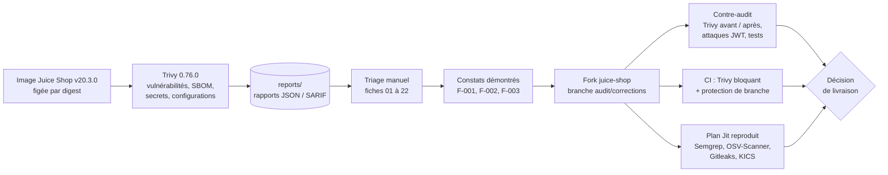

# Audit de sécurité applicative d’OWASP Juice Shop (Trivy, CI, plan Jit)

> **In English.** End-to-end security audit of OWASP Juice Shop `v20.3.0`: Trivy scans (image,
> SBOM, secrets, misconfigurations), hand triage of every finding, three proven JWT flaws fixed
> in a fork (forged tokens: HTTP 200 → 401, all tests still passing), a blocking Trivy CI gate
> demonstrated by a real refused merge, and an evidence-based delivery decision. The rest of the
> documentation is in French; start with the [delivery decision](docs/decision-livraison.md).

## Problème

Un scanner de vulnérabilités produit une liste, pas une décision. Sur une image comme Juice Shop,
Trivy remonte près d’une centaine de détections : lesquelles sont réellement atteignables ?
Lesquelles se corrigent sans casser l’application ? Comment empêcher qu’elles reviennent ? Et
peut-on livrer ?

Ce projet répond à ces questions sur une application volontairement vulnérable, en séparant
toujours **détection**, **preuve d’exploitabilité**, **correction vérifiée** et **décision**.

## Ce que contient le projet

- **Scans Trivy** de l’image figée par digest : vulnérabilités, SBOM CycloneDX, secrets,
  mauvaises configurations, avec la procédure pas à pas pour les rejouer.
- **Triage manuel** de chaque détection : une fiche par paquet ([`docs/analysis/`](docs/analysis/))
  qui vérifie l’usage réel du code avant de conclure.
- **Trois constats démontrés** sur l’authentification JWT, avec preuve et correction.
- **Corrections et contre-audit** dans un [fork de Juice Shop](https://github.com/othmane1244/juice-shop/tree/audit/corrections) :
  avant/après Trivy à périmètre constant, attaques JWT rejouées, tests de non-régression.
- **Contrôle CI bloquant** (Trivy) et protection de branche, avec une démonstration réelle de
  refus de fusion.
- **Plan « Minimal Viable Security » de Jit reproduit** avec des outils open source (Semgrep,
  OSV-Scanner, Gitleaks, KICS), Jit étant inaccessible.
- **Décision de livraison** argumentée à partir de critères fixés avant les scans.

## Architecture



Deux dépôts : **celui-ci** contient la méthode, les analyses, les rapports et les scripts ; le
**fork** [`othmane1244/juice-shop`](https://github.com/othmane1244/juice-shop) contient les
corrections et les workflows CI.

## Résultats

| Mesure | Résultat | Preuve |
| --- | --- | --- |
| Scan initial (20 octobre 2026) | 98 détections : 11 critiques, 27 élevées, 49 moyennes, 11 faibles ; toutes triées à la main | [bilan](docs/analysis/20-bilan-scan-initial.md), [fiches 01–21](docs/analysis/) |
| Constats démontrés | 3 : clé privée JWT codée en dur (F-002), confusion d’algorithme acceptant `alg: none` et HS256 (F-001), jetons sans expiration (F-003) | [`docs/findings/`](docs/findings/) |
| Attaques JWT après correction | Jetons forgés : HTTP 200 → **401** ; parcours JWT et fonctionnel 4/9 → **9/9** | [contre-audit § 2](docs/contre-audit.md) |
| Non-régression | **417/417** tests serveur et **545/545** tests API | [contre-audit § 3](docs/contre-audit.md) |
| Trivy avant / après, même base | 124 → **105** détections ; les 19 supprimées le sont toutes par les corrections | [contre-audit § 4](docs/contre-audit.md) |
| CI | Contrôle Trivy bloquant sur les nouvelles CRITICAL/HIGH corrigeables ; ligne de base de 28 exceptions justifiées (revue au 31 décembre 2026) | [contre-audit § 6](docs/contre-audit.md) |
| Démonstration du blocage | Une PR réintroduisant `jsonwebtoken` 0.4.0 échoue au contrôle ; sa fusion est refusée (HTTP 405) | [démonstration](docs/demonstration-blocage.md) |
| Verdict | **Non livrable en exposition réelle** (injections SQL, `eval`, MarsDB sans correctif possible) ; acceptable seulement comme cible d’entraînement isolée | [décision de livraison](docs/decision-livraison.md) |

L’écart entre 98 et 124 détections vient de la mise à jour de la base Trivy, pas d’un
changement de l’image ([contre-audit § 5](docs/contre-audit.md)).

## Par où commencer

Environ une heure pour les étapes 1 à 7 ; les fiches de l’étape 8 se consultent à la demande.

1. **[Décision de livraison](docs/decision-livraison.md)** : critères, verdict, risques
   résiduels, conditions. C’est le résumé de tout le dossier.
2. **Ce qui a été audité** : [identité de l’image](docs/identite-image.md)
   (pourquoi `cea5…` et `4060…` désignent la même image).
3. **Les trois constats démontrés**, dans l’ordre de priorité :
   [F-002](docs/findings/F-002-cle-privee-jwt-codee-en-dur.md) clé JWT codée
   en dur, [F-001](docs/findings/F-001-jwt-algorithm-confusion.md) confusion
   d’algorithme, [F-003](docs/findings/F-003-jetons-sans-expiration.md)
   jetons sans expiration.
4. **Vue d’ensemble des 98 détections** :
   [bilan du scan initial](docs/analysis/20-bilan-scan-initial.md) puis
   [synthèse des risques](docs/analysis/21-synthese-des-risques.md).
5. **[Contre-audit](docs/contre-audit.md)** : corrections vérifiées,
   avant/après Trivy à périmètre constant, écart 98 → 124, CI, workflows,
   risques acceptés.
6. **[Démonstration du blocage](docs/demonstration-blocage.md)** : une PR
   qui réintroduit une dépendance vulnérable est refusée.
7. **Jit (substitution)** : [accès bloqué et justification](docs/jit/acces-bloque.md), puis
   [comparaison Trivy / plan Jit reproduit](docs/jit/comparaison-trivy-plan-jit.md)
   (ce que Semgrep trouve dans le code et que Trivy ne voit pas).
8. **À la demande** :
   - fiches par paquet [01](docs/analysis/01-authentification.md) à
     [19](docs/analysis/19-paquets-debian.md), en commençant par
     [01 authentification](docs/analysis/01-authentification.md),
     [07 MarsDB](docs/analysis/07-marsdb.md) et
     [13 file-type](docs/analysis/13-file-type.md) ;
   - [22 — tri des 28 détections apparues après le 20 octobre](docs/analysis/22-nouvelles-detections.md) ;
   - contrôles initiaux : [secrets](docs/secrets/rapport-partageable.md),
     [mauvaises configurations](docs/misconfigurations/rapport-partageable.md),
     [SBOM](docs/sbom/README.md) ;
   - préparation Jit : [étude](docs/jit/README.md),
     [procédure de connexion non exécutée](docs/jit/procedure-connexion-fork.md) ;
   - [feuille de route](docs/feuille-de-route.md).

## Index des preuves

### Rapports bruts et résultats

| Preuve | Fichier | Utilisée dans |
|---|---|---|
| Scan Trivy initial, `v20.3.0`, 20 octobre (98 détections) | [reports/trivy-image-initial.json](reports/trivy-image-initial.json) | [20](docs/analysis/20-bilan-scan-initial.md), fiches 01–19 |
| Filtre CRITICAL/HIGH du scan initial (38) | [reports/trivy-image-high-critical.json](reports/trivy-image-high-critical.json) | [20](docs/analysis/20-bilan-scan-initial.md) |
| SBOM CycloneDX de l’image | [reports/sbom/juice-shop-initial.cdx.json](reports/sbom/juice-shop-initial.cdx.json) | [sbom](docs/sbom/README.md) |
| Rescan `v20.3.0`, base du 4 novembre (124) | [reports/trivy-image-v20.3.0-rescan.json](reports/trivy-image-v20.3.0-rescan.json) | [contre-audit § 4–5](docs/contre-audit.md) |
| Scan de l’image corrigée (105) | [reports/trivy-image-corrige.json](reports/trivy-image-corrige.json) | [contre-audit § 4](docs/contre-audit.md) |
| Comparaison avant/après | [reports/contre-audit/comparaison-trivy.json](reports/contre-audit/comparaison-trivy.json) | [contre-audit § 4](docs/contre-audit.md) |
| Comparaison initial / rescan | [reports/contre-audit/comparaison-initial-vs-rescan.json](reports/contre-audit/comparaison-initial-vs-rescan.json) | [contre-audit § 5](docs/contre-audit.md) |
| Tests JWT et parcours fonctionnel, origine (4/9) | [reports/contre-audit/jwt-fonctionnel-origine.json](reports/contre-audit/jwt-fonctionnel-origine.json) | [contre-audit § 2](docs/contre-audit.md) |
| Tests JWT et parcours fonctionnel, corrigé (9/9) | [reports/contre-audit/jwt-fonctionnel-corrige.json](reports/contre-audit/jwt-fonctionnel-corrige.json) | [contre-audit § 2](docs/contre-audit.md) |
| Modules chargés à l’exécution | [reports/contre-audit/modules-charges-execution.json](reports/contre-audit/modules-charges-execution.json) | [22](docs/analysis/22-nouvelles-detections.md) |
| Plan Jit reproduit : résultats par branche et par outil (SARIF, JSON ; secrets expurgés) | [reports/plan-jit-oss/](reports/plan-jit-oss/) | [comparaison](docs/jit/comparaison-trivy-plan-jit.md) |
| Plan Jit reproduit : synthèse chiffrée | [reports/plan-jit-oss/synthese.json](reports/plan-jit-oss/synthese.json) | idem |
| Protection de branche relue par l’API | [reports/demonstration-blocage/protection-audit-corrections.json](reports/demonstration-blocage/protection-audit-corrections.json) | [démonstration du blocage](docs/demonstration-blocage.md) |
| Run « Audit Trivy » en échec sur la PR T06 | [reports/demonstration-blocage/run-audit-trivy-t06.json](reports/demonstration-blocage/run-audit-trivy-t06.json) | idem |
| Fusion refusée (HTTP 405) | [reports/demonstration-blocage/tentative-fusion.json](reports/demonstration-blocage/tentative-fusion.json) | idem |
| PR T06 fermée sans fusion | [reports/demonstration-blocage/pr-3-t06.json](reports/demonstration-blocage/pr-3-t06.json) | idem |

Les sorties brutes des contrôles de secrets restent hors du dépôt ; seuls les
rapports expurgés sont versionnés. Les exports bruts Jit éventuels iraient
dans `reports/jit/brut/`, ignoré par git.

### Scripts (tous rejouables)

| Script | Rôle |
|---|---|
| [scripts/keycheck.py](scripts/keycheck.py) | Vérifie qu’une clé privée et `jwt.pub` forment une paire, sans afficher les clés (F-002) |
| [scripts/contre-audit-jwt.mjs](scripts/contre-audit-jwt.mjs) | Parcours fonctionnel et attaques JWT contre une instance ; n’écrit aucune clé |
| [scripts/compare-trivy.mjs](scripts/compare-trivy.mjs) | Compare deux rapports Trivy (avant/après) |
| [scripts/dump-loaded.js](scripts/dump-loaded.js) | Relève les paquets chargés et les bibliothèques projetées d’un processus Node (préchargé par `NODE_OPTIONS=--require` ; fichier de sortie : variable `DUMP_OUT`, par défaut `/x/loaded.json`) |
| [scripts/synthese-plan-jit.mjs](scripts/synthese-plan-jit.mjs) | Synthèse du plan reproduit et recoupement avec Trivy |

`keycheck.py` demande le paquet `cryptography` :
`python -m pip install -r scripts/requirements.txt`. Les scripts `.mjs` et
`.js` n’utilisent que les modules intégrés de Node.js.

### Dans le fork [`othmane1244/juice-shop`](https://github.com/othmane1244/juice-shop)

| Preuve | Emplacement |
|---|---|
| Corrections | Branche [`audit/corrections`](https://github.com/othmane1244/juice-shop/tree/audit/corrections), commits signés |
| Code audité sans correction | Branche [`audit/base-v20.3.0`](https://github.com/othmane1244/juice-shop/tree/audit/base-v20.3.0) (`f189f52`) |
| Lockfile repris de l’image `v20.3.0` | [`package-lock.json`](https://github.com/othmane1244/juice-shop/blob/audit/corrections/package-lock.json) |
| Ligne de base CI justifiée | [`.trivyignore.yaml`](https://github.com/othmane1244/juice-shop/blob/audit/corrections/.trivyignore.yaml) |
| Contrôle Trivy bloquant | [`.github/workflows/audit-trivy.yml`](https://github.com/othmane1244/juice-shop/blob/audit/corrections/.github/workflows/audit-trivy.yml), runs dans [Actions](https://github.com/othmane1244/juice-shop/actions/workflows/audit-trivy.yml) |
| Plan Jit reproduit | [`.github/workflows/plan-jit-oss.yml`](https://github.com/othmane1244/juice-shop/blob/ci/plan-jit-oss/.github/workflows/plan-jit-oss.yml) ([PR #1](https://github.com/othmane1244/juice-shop/pull/1)), run [42073516164](https://github.com/othmane1244/juice-shop/actions/runs/42073516164) ; alertes dans l’onglet [Security](https://github.com/othmane1244/juice-shop/security/code-scanning) |

## Sécurité

- **Cible isolée** : Juice Shop est volontairement vulnérable ; il n’est lancé qu’en local,
  publié sur `127.0.0.1` uniquement.
- **Images figées par digest** (Juice Shop et Trivy) : l’audit porte sur un contenu connu.
- **Aucun secret dans le dépôt** : les rapports de secrets sont expurgés (`REDACTED`), les
  exports bruts sont ignorés par git, et `keycheck.py` vérifie une paire de clés sans jamais
  l’afficher.
- **Secret scanning continu** : le workflow [Secrets (Gitleaks)](.github/workflows/secrets.yml)
  analyse les nouveaux commits à chaque push et à chaque PR ; ses actions sont épinglées par SHA.
  L’historique complet a été vérifié en local avec Gitleaks 8.30.1 (aucune fuite).
- **Chaîne CI** dans le fork : contrôle Trivy obligatoire et protection de branche, y compris
  pour les administrateurs.

Signaler un problème : voir [SECURITY.md](SECURITY.md).

## Reproduire l’audit

Environnement de référence : Windows, Docker Desktop et WSL 2 ; image `linux/amd64` ; accès à
l’application en local uniquement. Les sections 1 à 9 refont l’audit initial pas à pas. Le
contre-audit (image corrigée, avant/après, tests JWT) se rejoue avec les commandes et scripts
du [contre-audit](docs/contre-audit.md), à partir du fork.

Image auditée : `bkimminich/juice-shop:v20.3.0`, Linux/amd64, 24 couches. Docker indique
localement l’ID/RepoDigest
`sha256:cea5a4af4aacee498c491491af0408934ec81d004035c0a02ef3e54395e3bf27`.
Cette valeur est le digest de l’**index OCI** multi-plateforme (Docker
Desktop utilise le stockage containerd). Son manifeste `linux/amd64`
(`sha256:590a4516…`) a pour configuration
`sha256:40606cfb23b8937b60c1cab5a5980362e0a372223c1f86f6c3e68c1b003a823c`,
qui est l’`ImageID` des rapports Trivy et du SBOM : il s’agit bien de la même
image. Voir [identite-image.md](docs/identite-image.md).

### 1. Récupérer le dépôt

Dans PowerShell :

```powershell
git clone https://github.com/othmane1244/juice-shop-security-audit.git
cd juice-shop-security-audit
```

Utiliser la branche `main`, qui contient ce guide, les rapports initiaux et
les fiches d’analyse. Ne pas remplacer le rapport initial lors des
contre-audits : utiliser un nouveau nom de fichier.

### 2. Vérifier les outils

Démarrer Docker Desktop, puis vérifier WSL, Git et Docker :

```powershell
wsl --list --verbose
git --version
docker version
docker run --rm hello-world
```

Résultats observés sur le poste de référence : Ubuntu sous WSL 2, Git
`2.52.0.windows.1` et Docker `29.1.2`. Ces versions ne sont pas des
prérequis universels.

### 3. Fixer les images utilisées

Les versions retenues sont Juice Shop `v20.3.0` et Trivy `0.76.0`.
Les digests fixent le contenu des images :

```powershell
$juiceImage = "bkimminich/juice-shop@sha256:cea5a4af4aacee498c491491af0408934ec81d004035c0a02ef3e54395e3bf27"
$trivyImage = "aquasec/trivy@sha256:2416d1f74045b57274df1a340eee6b510cacd73c66a6ccb8da092b117eb7d222"
```

Redéfinir ces variables après l’ouverture d’une nouvelle session
PowerShell.

### 4. Télécharger et lancer Juice Shop

```powershell
docker pull $juiceImage
docker run -d --name juice-shop-audit -p 127.0.0.1:3000:3000 $juiceImage
docker ps --filter name=juice-shop-audit
docker logs --tail 50 juice-shop-audit
```

Ouvrir [http://localhost:3000](http://localhost:3000). Le message de
démarrage attendu est `Server listening on port 3000`. Les avertissements
Alchemy et LLM concernent des défis hors du périmètre.

Créer le conteneur une seule fois. Pour le gérer ensuite :

```powershell
docker stop juice-shop-audit
docker start juice-shop-audit
```

Le conteneur Juice Shop n’a pas besoin de fonctionner pendant le scan
de son image.

### 5. Préparer Trivy et son cache

```powershell
docker pull $trivyImage
docker run --rm $trivyImage --version
New-Item -ItemType Directory -Force .\reports
docker volume create trivy-cache
```

### 6. Télécharger la base Trivy

```powershell
docker run --rm --mount "type=volume,source=trivy-cache,target=/root/.cache/trivy" $trivyImage image --db-repository ghcr.io/aquasecurity/trivy-db:2 --download-db-only --timeout 60m
```

En cas d’erreurs DNS dans le conteneur, ajouter `--dns 8.8.8.8` après `--rm`. Une autre
source de base possible est `public.ecr.aws/aquasecurity/trivy-db:2`. Ces options dépendent du
réseau ; elles ne sont pas des prérequis.

### 7. Effectuer le scan initial de l’image

Depuis la racine du dépôt, lancer le scan distant :

```powershell
docker run --rm --mount "type=volume,source=trivy-cache,target=/root/.cache/trivy" --mount "type=bind,source=$($PWD.Path)\reports,target=/reports" $trivyImage image --db-repository ghcr.io/aquasecurity/trivy-db:2 --image-src remote --platform linux/amd64 --scanners vuln --timeout 15m --format json --output /reports/trivy-image-initial.json $juiceImage
$LASTEXITCODE
Get-Item .\reports\trivy-image-initial.json
```

Si le téléchargement distant échoue avec une erreur réseau ou
`unexpected EOF`, et si l’image exacte est déjà présente localement,
l’exporter puis scanner l’archive. Cette méthode a produit le rapport de
référence :

```powershell
docker save --output .\reports\juice-shop-image.tar $juiceImage
docker run --rm --mount "type=volume,source=trivy-cache,target=/root/.cache/trivy" --mount "type=bind,source=$($PWD.Path)\reports,target=/reports" $trivyImage image --db-repository ghcr.io/aquasecurity/trivy-db:2 --scanners vuln --timeout 15m --format json --output /reports/trivy-image-initial.json --input /reports/juice-shop-image.tar
$LASTEXITCODE
Get-Item .\reports\trivy-image-initial.json
Remove-Item .\reports\juice-shop-image.tar
```

Vérifier que le code de sortie est `0` et que le JSON a été créé. Un code `0` signifie que le
scan s’est exécuté ; il ne signifie pas qu’aucune vulnérabilité n’a été trouvée. Le scan ne
lance pas l’application.

### 8. Lire le rapport

```powershell
$rapport = Get-Content -Raw .\reports/trivy-image-initial.json | ConvertFrom-Json
$constats = @($rapport.Results | ForEach-Object { $_.Vulnerabilities } | Where-Object { $null -ne $_ })
$constats.Count
$constats | Group-Object Severity | Select-Object Name, Count
```

Le rapport de référence du 20 octobre 2026 contenait 98 détections : 11 critiques, 27
élevées, 49 moyennes et 11 faibles. Ces lignes ne correspondent pas nécessairement à 98 CVE
distinctes, et le résultat change quand la base Trivy est mise à jour.

Pour afficher le détail d’une détection :

```powershell
$rapport.Results |
    ForEach-Object { $_.Vulnerabilities } |
    Where-Object { $_.VulnerabilityID -eq "CVE-2015-9235" } |
    Select-Object -First 1 |
    Format-List VulnerabilityID, PkgName, PkgPath, InstalledVersion, FixedVersion, Severity, Title, Description, PrimaryURL
```

### 9. Première alerte étudiée : CVE-2015-9235

- Paquet : `jsonwebtoken` `0.1.0`
  (`juice-shop/node_modules/express-jwt/node_modules/jsonwebtoken/package.json`),
  aussi signalé pour la version `0.4.0`.
- Gravité indiquée par Trivy : `CRITICAL` ; version corrective : `4.2.2`.
- Sujet : contournement de vérification si un jeton signé avec un
  algorithme asymétrique est présenté avec un algorithme symétrique.

Une détection ne prouve pas à elle seule qu’un chemin exploitable existe : il faut vérifier
l’usage réel du paquet. **Statut final :** usage confirmé dans le code
([01](docs/analysis/01-authentification.md),
[F-001](docs/findings/F-001-jwt-algorithm-confusion.md)) ; **corrigé** dans le
fork (`jsonwebtoken` 9.0.3, RS256 seul accepté). Les jetons forgés sont
refusés (HTTP 401) et la CVE n’apparaît plus dans le scan de l’image corrigée
([contre-audit](docs/contre-audit.md)).

## Principes d’interprétation

- Une détection ne prouve pas automatiquement qu’elle est exploitable.
- L’absence d’alerte ne garantit pas la sécurité.
- Une erreur technique signifie que l’audit est incomplet.
- Une exclusion n’est pas une correction.
- Toute correction doit être vérifiée par un nouveau contrôle et un
  test de fonctionnement.

## Limites

- **Pas un audit Jit** : la plateforme Jit était inaccessible ; son plan a été reproduit avec
  des outils open source, et les résultats sont ceux de ces outils
  ([constat](docs/jit/acces-bloque.md)).
- **Risques résiduels sans correctif** : MarsDB (CRITICAL, atteignable, aucun correctif ne
  sortira), `decompress` (2 CRITICAL), `hbs` ; les défis volontaires de Juice Shop (injections
  SQL, `eval`, redirection ouverte, listages de répertoires) restent en place par conception
  ([décision § 4](docs/decision-livraison.md)).
- **La CI ne bloque pas tout** : les vulnérabilités sans correctif (`--ignore-unfixed`) et les
  mauvaises configurations (seulement collectées) ne bloquent pas une PR ; une seule régression
  a été démontrée ; le propriétaire du dépôt peut retirer la protection ou ajouter une exception
  dans la PR elle-même ([démonstration § 5](docs/demonstration-blocage.md)).
- **Résultats datés** : les comptes de détections dépendent de la base Trivy du jour (98 le
  20 octobre, 124 le 4 novembre sur la même image).
- **Environnement de référence unique** : la procédure est décrite et vérifiée pour Windows,
  Docker Desktop et WSL 2 ; les commandes sont écrites pour PowerShell.
- **Hors périmètre** : l’outil AuditTrace et l’application EventLab du plan initial, remplacés
  par Juice Shop ([feuille de route](docs/feuille-de-route.md)) ; tests d’intrusion complets.

## Contexte

Projet du module « Compliance et Gouvernance », cycle ingénieur IA & Cybersécurité (ENSA Béni
Mellal), réalisé en binôme, octobre-novembre 2026. Le remplacement de Jit par des outils open
source est une substitution décidée par l’équipe et justifiée (jit.io inaccessible).

## Licence

[MIT](LICENSE). Les rapports bruts de `reports/` sont des sorties d’outils sur OWASP Juice
Shop, lui-même sous licence MIT.
